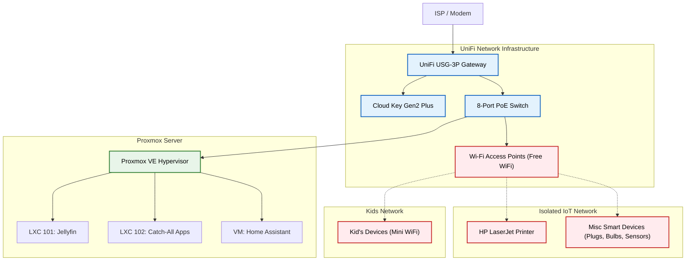

# Personal Enterprise Data & Infrastructure Lab

## 🌐 Overview
A self-hosted, highly available homelab environment designed to simulate enterprise infrastructure, automated data pipelines, and segregated network security. This project serves as a testing ground for container orchestration, database integrity, and efficient storage lifecycle management.

---

## 🏗️ System Architecture & Hardware
To ensure high performance and protect system drives from excessive write wear, the infrastructure separates core hypervisors from bulk data storage:
* **Hypervisor:** Proxmox VE running on a dedicated Dell Optiplex node.
* **Storage Allocation:** System boot volumes are isolated from heavy input/output tasks, routing all container appdata, logs, and media databases directly to a high-speed **2TB secondary internal SSD**.
* **Containerization:** Lightweight Linux Containers (LXCs) host isolated services to maintain clean boundaries between media streaming, network automation, and data indexing.

---

## 🔒 Network Topology & Security (UniFi Stack)
Network segmentation is critical for isolating IoT devices from core data traffic. The infrastructure is managed via a UniFi gateway and switch ecosystem:
* **Primary VLAN ("Free Wi-Fi"):** Dedicated trusted network for primary user devices and workstations.
* **Isolated IoT VLAN:** Restricts smart home hardware, printers, and background appliances from accessing internal server shares.
* **Local DNS & Ad-Blocking:** Implements network-wide DNS filtering at the gateway level to optimize bandwidth and secure local endpoints.

---

## 💾 Data Pipelines & Storage Architecture

In any robust data or supply chain environment, protecting system integrity while managing high-throughput data flows is critical. This infrastructure is architected to eliminate single points of failure and protect boot volumes from excessive read/write wear:

* **Storage Tiering & Isolation:** 
  * **Boot / System Drive:** Isolated strictly to a lightweight hypervisor boot volume to prevent unnecessary write fatigue.
  * **Secondary High-Performance Tier:** All heavy input/output (I/O) workloads—including container appdata, relational databases, system logs, and media pipelines—are routed directly to a dedicated **2TB internal SSD** (`/mnt/pve/ssd2tb/`).
* **Automated Data Ingestion & Indexing:** 
  * Implements automated file-staging and directory mapping for media and document assets, ensuring strict folder hierarchies before downstream ingestion by services like Jellyfin and Audiobookshelf.
* **Data Integrity & Lifecycle Management:** 
  * Regular Proxmox snapshotting and automated container backups ensure zero data loss during system updates, mimicking enterprise disaster recovery protocols.

---


```markdown
* Explore the full [Catch-All Container Architecture Documentation](docs/docker-catchall.md) for detailed Docker Compose configurations and storage mapping.
* Explore the full [Home Assistant VM Architecture Documentation](docs/home-assistant.md) for details on virtual machine resource allocation and local automation governance.
* Explore the full [Jellyfin Media Server Documentation](docs/jellyfin-container.md) for details on media streaming isolation and high-throughput SSD storage mapping.
* Explore the full [UniFi Network Topology & VLAN Documentation](docs/network-topology.md) for details on hardware segmentation, firewall rules, and VLAN security.
* Explore the full [Data Pipelines & Storage Architecture Documentation](docs/data-pipelines.md) for details on storage tiering, hardware isolation, and data recovery workflows.
```
